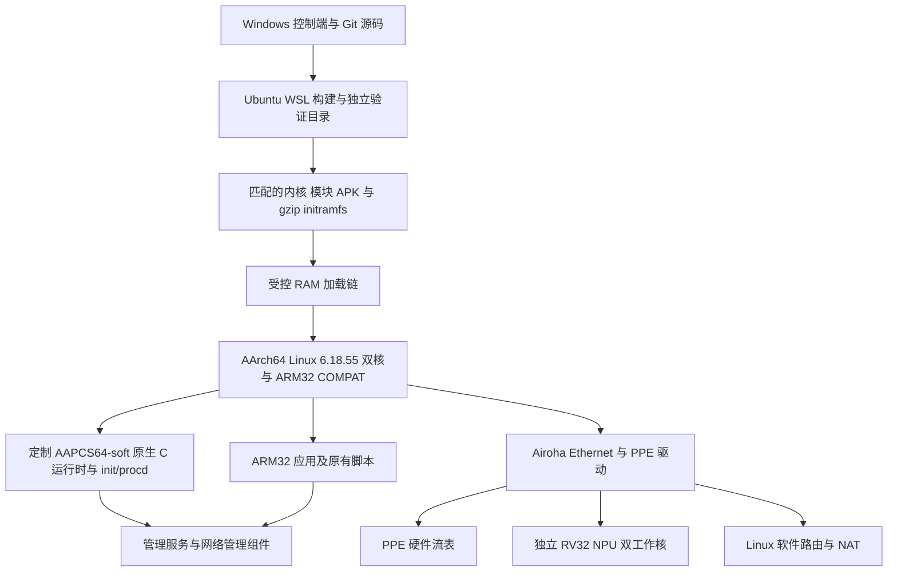

# 项目架构、当前状态与下一阶段目标

更新：2026-11-05。本文区分历史实机验收、当前离线候选和未完成目标。
历史镜像已启动过，不代表路由器现在仍在运行该镜像。

## 整体架构

* **启动与内存**：只使用 initramfs/RAM 启动。历史受控链经过 ARM32
  中间系统再进入 ARM64；当前打包的 Telnet 分发包含较早的 X-Wrt 镜像，
  尚未接入新候选。内核有效 Image 必须止于原有 `0x84000000` 边界之前。
* **内核**：ARM64 Linux 与原生模块负责调度、设备、网络和驱动；COMPAT
  为独立 ARM32 进程提供系统调用兼容。内核位数不决定应用包 ABI。
* **用户空间**：当前是混合系统。原生 init/procd 和部分 C 组件使用私有
  AAPCS64-soft ABI、独立解释器和库路径；多数应用仍使用 ARM32 软件包。
  不同 ABI 的动态库不能在同一进程中混用。
* **网络数据面**：Linux 驱动配置 PPE 流表和 NPU 相关接口；bridger 经 TC
  管理 L2 规则。PPE SRAM 流表与独立的 NPU 无线队列不是同一机制。
  现有 L2 成果不等于 WAN/NAT 加速；未通过的路由路径保留软件回退。
* **构建与安装**：源码锁定、内核/模块 ABI、正常签名 APK 事务、CPIO、
  Image 和 RAM 加载器共同决定候选是否可测试。单项 ELF 或对象编译通过
  不能替代完整镜像验收。公开仓库仅包含选定源码，不是完整 SDK 镜像。

## 已实现与尚未实现

| 项目 | 当前证据 | 尚未完成 |
| --- | --- | --- |
| ARM64 内核 | 基准再次双核启动；新内核、匹配模块和完整 FIT 已构建 | 新候选内核/模块/默认服务的实机验收 |
| 原生 C 核心 | 历史镜像 58 个原生软 ABI ELF 路径，正常包归属 | 完整原生应用体系和统一 SDK |
| 标准 A53 软件包 | 普通 AArch64 加载器曾在 SIMD 指令处 SIGILL | 标准 ABI 与指令集的真实兼容能力 |
| 原生 netifd | 15 ELF 静态检查、签名事务；隔离 ARM64 实机存活、ubus 注册与五个 VM 模块加载通过 | 默认服务的 DHCP/PPPoE/Wi-Fi/脚本子进程与新镜像验收 |
| 原生 Web/Lua | 90 路径预览的隔离实机测试 | 完整默认服务迁移、镜像与持续运行 |
| Go、C++、btop | 应用以现有 ARM32 包保留；Go 首个 SIMD 故障已定位 | 原生运行时/工具链与真实应用验收 |
| Ethernet/Wi-Fi 管理 | 历史镜像的普通 MTU、UI、严格 HTTPS、双频功能检查 | 新镜像重新验证；Mesh 外部对等节点等覆盖 |
| L2 NPU/PPE | 历史镜像有规则、吞吐、CPU 对照、完整性和生命周期证据 | 新 SRAM/资源生命周期策略的硬件验收 |
| WAN/NAT 硬件卸载 | 有 CT/UNB 诊断与软件路由 | 完整路由动作、身份对应、撤销/排空、统计和真实 BIND |
| IPv6 硬件卸载 | 原型与部分 CPU 测试 | 实际路由与硬件生命周期验收 |
| X-Wrt 移植 | 初版 SRAM-only 策略；129 项主机检查；完整匹配内核/模块/FIT 构建 | 941-04 资源保留等后续移植及新驱动实机测试 |
| SSH 恢复守护 | r2 修复缺少 stat，23 组测试；ARM32/ARM64 实际运行和心跳；一轮 60 秒超时返回原厂 | 默认时长、ARM64 超时、强制回退、硬锁与多轮复位验收 |
| Flash 保护 | 历史受保护镜像的十个 MTD 与 BMT 防写检查 | 每个新候选重新核对全部保护 |
| XZ initramfs | 曾有静态构建与空间检查 | 首次实机启动失败，原因未证实，不作为已可用方案 |

基准与本轮证据见 [STATUS](STATUS.md)、[N1 v3 实机结果](N1-V3-TARGET.md)
和[最新构建及实机回执](FRESH-KERNEL-AND-RECOVERY.md)。吞吐结论仅适用于对应
镜像、客户端与测试方向，不外推成新候选或 WAN/NAT 成果。

## 标准 A53 软件包的关键障碍

历史 EL2 探测读得 `ID_AA64PFR0_EL1=0x0000000001ff2222`，FP 与 AdvSIMD
字段均为 `0xf`；普通 AArch64 musl 加载器的 `ldr q31` 曾在实机触发 SIGILL。
这些证据表明当前执行环境不能直接运行依赖相应指令的普通包。它们尚未
证明究竟属于硬件裁剪、熔丝还是更高特权级配置问题，不据此臆测硬件开关。

Linux 的[寄存器定义](https://github.com/torvalds/linux/blob/v6.18/arch/arm64/tools/sysreg)
及 Arm 的[AAPCS64 规范](https://github.com/ARM-software/abi-aa/blob/main/aapcs64/aapcs64.rst#soft-float)
可用于解释能力字段和 ABI 边界。现有 Clang AAPCS64-soft 改变浮点参数的传递方式，
不能让标准 A53 二进制自动兼容。不能通过伪造 HWCAP、改包标签或混接动态库
来宣告兼容成功。

目标仍是正常使用标准 A53 软件包。优先核查可证实的原生路径；若原生
FP/SIMD 确认不可用，允许研究软件指令模拟作为备用，必须单独标明性能、
内存和系统调用限制。定制软 ABI 重编译的阶段成果不等于该目标已完成。

## 当前主要问题

1. **标准包能力缺口**：FP/SIMD 与 ABI 是根本约束；原生 Go/C++ 也不能靠修复
   第一处非法指令就验收整个运行时。
2. **PPE 失败后的资源生命周期**：当前超时路径仍可能清除物理槽所有者并释放
   被硬件引用的对象。需要联动移植 SMAC 引用、物理 FOE 预留、替换/销毁和
   设备事件路径；清 enable 位或控制器 ACK 不构成排空证明。详见
   [X-Wrt 移植审计](XWRT-NPU-PORT.md)。
3. **无人现场恢复**：用户态 daemon 无法处理整个内核硬锁；历史 warm reset
   可能卡在 U-Boot NAND 初始化。恢复链必须接受实际测试，不能依赖现场插拔电源。
4. **构建树恢复**：按成员清单已物化 1,588,255 个文件和 16,222 个符号链接，
   410 个关键输入校验通过。469 个损坏生成缓存仍被省略，完整 SDK 尚未验收。
   新内核使用锁定源码和正常补丁顺序独立构建，没有导入这些损坏缓存。
5. **镜像空间与一致性**：新 219 包候选的有效 Image 余量实测为 262,144 字节，
   精确内嵌 CPIO、模块布局与全部 MTD/BMT 保护检查通过；新镜像仍未启动。
6. **应用与设备覆盖**：新默认服务、Mesh 对等节点、端口/热插拔、PCIe 初次交接、
   watchdog 真实复位和完整统计仍有未覆盖场景。

## 下一阶段目标与完成判据

| 顺序 | 工作 | 完成判据 |
| --- | --- | --- |
| A | 恢复并审查 Linux 构建树 | 最终恢复回执、关键文件检查、损坏缓存按锁定源码/补丁重建；可重复构建 |
| B | 解决标准 A53 包兼容路径 | 保留标准 ABI；真实包覆盖整数、FP/SIMD、动态链接、C++、Go、线程/信号/TLS；原生与模拟结果分开报告 |
| C | 移植 X-Wrt PPE 资源机制 | 超时/部分写/槽复用/销毁/设备事件故障测试，真实 ARM64 构建，保留已有 L2/VLAN/DSA/WDMA 行为 |
| D | 构建匹配的新 initramfs | 正常 APK 归属、匹配模块、精确 CPIO、gzip Image 边界、全部 MTD/BMT 保护及加载器检查通过 |
| E | 无人现场 RAM 上机测试 | 可用管理与恢复路径；原生服务、网络、严格 TLS、完整性、软件对照、NPU 生命周期与故障回退实测 |
| F | 后续功能完善 | 受控路由 BIND/NAT、IPv6、真实 per-flow 统计、Mesh 和剩余设备覆盖分别验收 |

Windows 控制端不更改路由/VPN/接口优先级，不读取保存的无线密码。initramfs
测试沿用 RAM 启动约束；不做持久 Flash 安装。始终保留中文 LuCI、Argon、
wpad-mbedtls/Mesh、curl、Lua/Nixio、btop、bridger，以及未登录且默认关闭的
Tailscale 和 Passwall/sing-box 选择。

达到五小时额度剩余 10% 时，保存回执与交接、审查提交并推送 GitHub，然后暂停
目标和对话。完整条目达到完成判据时通知用户，由用户更新目标清单。
